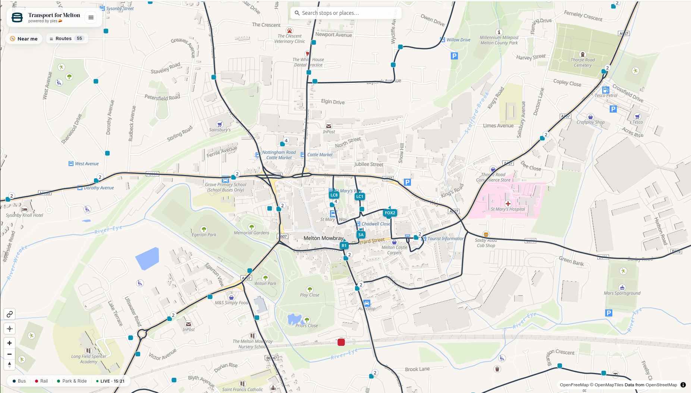
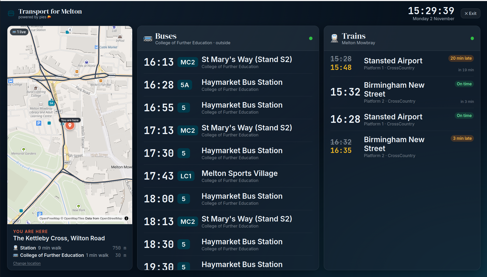
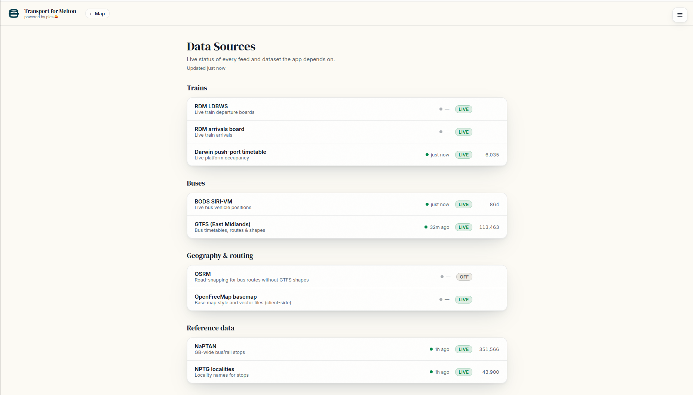
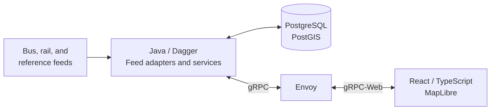

<div align="center">


# Transport for Melton

***Powered by pies. 🥧***

Bus and train departures, live buses, and route maps for Melton Mowbray.

[](https://github.com/parkie213/tfm/actions/workflows/ci.yml)
[](LICENSE)
[](docs/development.md#validation)
[](frontend/package.json)

[Why TfM?](#why-tfm) · [Features](#features) · [Quick start](#quick-start) · [How it works](#how-it-works) ·
[Technology choices](#technology-choices) · [Engineering notes](#engineering-notes) ·
[Development](docs/development.md)

</div>

## Why TfM?

I quite like using the buses in London. The live departure boards at the bus stops are great,
so I thought: what if the local shops had a departure board? I could be sitting in Spoons until
the bus is a minute away.

The UK has quite a lot of really good freely available transport data, so I put it together
and hosted it at tfm.org.uk. It's not running there any more, but the code is here.

Once it was deployed, my Grandad and I took it for a spin and got the bus into town. The app
worked well, but I was shocked at the price of a ten-minute bus journey and I haven't taken
the bus since.

Another time, I was getting the train to Birmingham. The station board and platform announcement
were reporting a 40-minute delay, while TfM was showing a seven-minute delay from Darwin.
Darwin turned out to be right. 🤷

This was one of my first projects with Claude. When I decided to shut down the VPS, I thought
it was worth keeping around as a portfolio project. Before publishing it, I split the Java
backend into smaller modules with clearer responsibilities and simplifying some of the questionable backend interactions.

## Features

### Explore the town



- Search for a stop or place, or find nearby stops with a one-shot location lookup.
- Select a stop for its departures, then open a service to see its calling points.
- Browse bus routes and follow live vehicles where the upstream feed provides coverage.
- Check train departures, delays, platforms, and operator-supplied coach information.

### Put it on a screen



The kiosk view brings a local map and bus and train boards together in a layout for a larger
screen. Enter the venue's address, then choose up to ten nearby bus stops to include. The saved
selection survives reloads, and each departure shows its boarding stop. The map fits the venue
and selected stops, with walking-distance estimates for each. Use **Change bus stops** to update
the selection later. Open it with `?view=tv`.

### Know where the data stands

<details>
<summary>See the data-sources view</summary>

<br>


</details>

Feed availability and freshness have their own page. Live information depends on upstream
coverage; an absent bus marker does not mean that a service is not running. Optional Darwin
feeds add train calling points and platform occupancy.

## Quick start

> **Requires** Docker with the Compose plugin and an internet connection.
> Scheduled buses and the map work without credentials; live buses and trains need your own
> upstream subscriptions.

From the repository root:

```bash
cp deploy/.env.example deploy/.env
# Optional: add live-feed credentials to deploy/.env.
cd deploy
docker compose up --build
```

Open **http://localhost:5174** for the map or **http://localhost:5174/?view=tv** for the kiosk.

The first run downloads stop and locality data and the East Midlands bus timetable. Allow
several minutes for boards and routes to populate. The Java container defaults to a 3 GB heap;
allow additional memory for PostgreSQL and image builds. The map uses the hosted OpenFreeMap
Liberty style, with no basemap archive or API key to configure.

The stack binds its published ports to localhost. To stop it, run `docker compose down` from
`deploy/`; the database and downloaded timetable cache persist between runs.

### Optional feeds

| Setting | Enables |
| --- | --- |
| `BODS_API_KEY` | Live bus positions from BODS SIRI-VM |
| `DARWIN_TOKEN` | Live train departures from RDM LDBWS |
| `DARWIN_ARRIVALS_BASE_URL`, optionally `DARWIN_ARRIVALS_TOKEN` | Train arrivals from an arrivals product |
| `DARWIN_KAFKA_*` | Train calling points, headcodes, and platform occupancy |

A fresh database gains train journey-detail coverage as Kafka schedules arrive. Unconfigured
live features show unavailable states. See the [environment example](deploy/.env.example) and
[Darwin integration notes](docs/darwin-timetable.md) for configuration.

## How it works

TfM brings several transport feeds into one local view. The table describes what the current
application uses from each source; some feeds contain more information than TfM consumes.

### What each source provides

| Source | What TfM uses it for | How it reaches the app |
| --- | --- | --- |
| **Darwin LDBWS departures (REST)** | Train departure boards: scheduled and expected times, delays, cancellations, destinations, platforms, operators, coach information, and disruption messages where supplied. | Java requests a station board on demand and caches each station/row-count response for 30 seconds. |
| **Darwin arrivals product (REST, optional)** | Arrival times and origins, joined with departures by service ID to form the combined station board. | A separate configured arrivals endpoint, also cached for 30 seconds. |
| **Darwin Push Port (Kafka, optional)** | Schedules supply train calling points, headcodes, origins, and destinations. Platform and movement updates supply platform confirmation and whether a train has arrived but not departed. | A continuous subscription; schedules are persisted in PostgreSQL and live updates maintain application state. |
| **BODS GTFS** | Scheduled bus departures, operating calendars, routes, calling points, and route shapes. | Regional ZIP downloads, streamed into PostgreSQL during timetable refreshes. |
| **BODS SIRI-VM (optional)** | Reported bus positions and timestamps, used for map markers and matching vehicles to scheduled trips. | Java polls the live vehicle feed and publishes snapshots to subscribed browsers. |
| **NaPTAN / NPTG** | Stop names, types, coordinates, rail station references, and the towns and localities used by search. | Reference-data downloads imported into PostgreSQL. |
| **OpenFreeMap / OpenStreetMap** | The background map, its roads, buildings, and place labels. | MapLibre loads the hosted style and vector tiles in the browser. |
| **OSRM (optional)** | Road geometry for bus routes without suitable GTFS shapes. | Java calls a separately managed routing server; the local stack does not require one. |

The names above include a few transport and software acronyms:

- **LDBWS** — Live Departure Boards Web Service, the API for requesting Darwin station boards.
- **BODS** — Bus Open Data Service, the source of bus timetable and live vehicle data.
- **GTFS** — General Transit Feed Specification, the format used for bus timetables, calendars,
  stops, and route shapes.
- **SIRI-VM** — Service Interface for Real Time Information — Vehicle Monitoring, the format used
  for live bus position reports.
- **NaPTAN** — National Public Transport Access Nodes, the national dataset of transport stops
  and access points.
- **NPTG** — National Public Transport Gazetteer, the dataset of towns, villages, and localities.
- **OSRM** — Open Source Routing Machine, the optional road-routing engine.

Darwin, Kafka, MapLibre, and OpenFreeMap are product or project names rather than acronyms.
Darwin is the railway's passenger-information system; Kafka is the messaging platform carrying
its push updates; MapLibre renders the map; OpenFreeMap provides the hosted map style and tiles.

**REST boards and Kafka currently have different jobs.** The expected arrival/departure times
shown on train boards come from REST. Kafka enriches calling points and platform information;
its movement predictions do not currently update those board times.

The service could be updated to get all train departure/arrival data from kafka but the simpler REST implementation is working well enough.

The browser receives complete train-board snapshots from Java every 15 seconds while subscribed.
That is a separate interval from the 30-second REST cache: a browser update can reuse a cached
upstream response. Optional arrivals can be unavailable while departures continue to work.

A fresh Kafka consumer without a valid committed offset starts at the latest messages. It does
not automatically reconstruct a complete timetable, so calling-point and platform coverage can
be incomplete until the relevant schedules arrive. See the
[Darwin integration notes](docs/darwin-timetable.md).



The backend runs as one application, with separate modules for the transport model, feed
adapters, persistence, and services. Background loaders ingest reference and timetable data;
shared server streams deliver board and bus updates. The map and kiosk use the same Protobuf
API, with generated Java and TypeScript types.

Route geometry uses GTFS shapes. A separately managed OSRM server can optionally provide road
routing; it is not required by the local stack.

## Technology choices

These choices mostly reflect tools I enjoy using and where I am most comfortable working.

| Technology | Why I chose it | Where to look |
| --- | --- | --- |
| **Java 25** | I like Java, and it is where I am most comfortable putting the transport logic. | [Application services](backend/tfm-server/src/main/java/uk/org/tfm/server/service) |
| **Dagger** | I like explicit dependency wiring and finding missing or conflicting bindings at compile time rather than when the application starts. | [Application component and modules](backend/tfm-server/src/main/java/uk/org/tfm/server/dagger) |
| **Protobuf / gRPC** | Personal preference. I like defining the API in a schema and generating the Java and TypeScript types from it. | [API contract](backend/tfm-proto/src/main/proto/tfm/v1) |
| **React / TypeScript / MapLibre** | The UI makes the backend usable. I aim to keep transport rules in Java because I understand that side better; React handles the views, interaction, and map rendering. | [Frontend](frontend/src) |
| **PostgreSQL / PostGIS** | Stores the timetable and reference data, with spatial queries for map geometry. | [Stores and importer](backend/tfm-storage-postgres/src/main/java/uk/org/tfm/storage/postgres) |
| **Docker Compose / Envoy** | I like Docker for running the stack together. Envoy connects browser gRPC-Web requests to the Java gRPC server. | [Local stack](deploy/docker-compose.yml) and [proxy configuration](deploy/envoy.yaml) |
| **JUnit / Testcontainers** | Personal preference for Java tests, with a real PostgreSQL/PostGIS instance for the import integration tests. | [Import correctness and memory tests](backend/tfm-server/src/test/java/uk/org/tfm/server/gtfs/GtfsImportRoundTripTest.java) |

### Why not Spring Boot?

Java and Dagger are a combination I enjoy working with, and I value Dagger's compile-time
checks for dependency wiring. That is a preference, rather than a claim that Spring Boot
would be unsuitable for this app.

The Java backend is the focus of the project: feed integration, timetable ingestion, persistence,
and the API. React provides the map, boards, and kiosk views, with browser-side animation to
keep vehicle markers moving smoothly between updates.

## Engineering notes

### Importing a regional timetable without filling the heap

The original GTFS importer parsed the entire feed into Java collections before writing to
PostgreSQL. The failing East Midlands feed was a 253 MB ZIP containing roughly 20.9 million
shape points and 4.6 million stop times. Expanding those compressed CSV rows into millions of
Java objects and strings exhausted a 3 GB heap. Memory pressure also disrupted unrelated
live-feed threads.

The replacement reads each table row by row, sending small batches to PostgreSQL using its
bulk-loading command, `COPY`, rather than keeping the whole feed in memory. The
[GTFS reader](backend/tfm-adapter-gtfs/src/main/java/uk/org/tfm/adapter/gtfs/GtfsTimetableSource.java)
handles the CSV files; the
[database importer](backend/tfm-storage-postgres/src/main/java/uk/org/tfm/storage/postgres/PostgresTimetableImporter.java)
owns the write buffer and transaction. If parsing or writing fails, the transaction rolls back
so a partial timetable is not saved.

In a real-feed check on 2 November 2026, using a 253 MB East Midlands ZIP:

| | Original importer | Streaming importer |
| --- | --- | --- |
| Heap limit | 3 GB | 1 GB |
| Result | Out of memory | Completed |
| Container memory during load | Over 3 GB before failure | Roughly 260–310 MB steady; around 800 MB at JVM startup |
| Rows imported | Load failed | 4.6 million stop times and 20.9 million shape points |
| Timetable load time | Load failed | 121 seconds, followed by an 85-second geometry rebuild |

Tests compare database contents against the original importer, check rollback on a broken
feed, and import two million synthetic rows in a separate JVM with a 128 MB heap to guard
against collecting the feed in memory again.

One remaining limitation: timetable replacement holds a database lock during the load, so
timetable reads can wait for roughly two minutes. Loading into staging tables before a short
swap is a future improvement.

## Development

The [development guide](docs/development.md) covers frontend hot reload, backend tests,
module structure, and regenerating the API types. Backend validation uses JDK 25 and Maven;
frontend validation uses Node.js 26 and npm. CI runs both builds.

Backend tests cover feed parsing, timetable handling, bus progress estimation, route geometry,
and selected service behavior. The frontend has type checking and build validation, with
[manual smoke checks](docs/user-journeys.md) for the main user journeys.

## Data and attribution

Bus data comes from BODS GTFS and SIRI-VM; stops and places from NaPTAN/NPTG; train boards from
RDM LDBWS, with optional Darwin schedules and platforms. Maps are provided by OpenFreeMap
with OpenStreetMap data. See the [in-app attribution page](frontend/src/pages/AboutView.tsx).

TfM is a personal project, unaffiliated with transport operators or local authorities.
Source code is [MIT licensed](LICENSE). Third-party data and assets retain their own terms
and attributions.

<div align="center">
<br>
<sub>Made for Melton Mowbray. Powered by pies.</sub>
</div>

### Platform reconciliation

`GetStationPlatforms` assembles the persisted platform layout and the combined REST station board
in Java. Each platform shows its next two REST services in scheduled order; where REST has no
assigned service, the API falls back to available Kafka platform observations. Either source can
fail independently. `board_available` and `platform_data_available` describe successful reads,
while `platform_feed_enabled` describes Kafka configuration, not completeness.

REST LDBWS service IDs are not Darwin RIDs. There is currently no verified bridge between them,
so REST occupants retain unknown presence and never inherit another train's platform confirmation
or actual arrival. Kafka platform and movement state correlate by dated RID and station, rather
than reusable headcode. A Kafka observation distinguishes unknown presence, actual arrival without
departure, and observed departure/passage. Empty inventory rows do not prove a platform is clear.
A fresh Kafka consumer starts at latest and cannot reconstruct complete occupancy automatically.
REST remains authoritative for board times, cancellation and coach information (30-second cache);
Kafka movement forecasts do not replace those times. Platform polling remains every ten seconds,
separate from the station board's fifteen-second browser stream.

`GetNearbyStops` supplies active nearby bus, rail and metro stops using PostGIS geography distances.
Radius/type filtering and distance ordering happen before the result limit; equal distances use ATCO
code order. The default radius is 800 m (maximum 5 km), and the default limit is 100 (maximum 500).
The response includes distances in metres and an explicit truncation flag. Near-me and kiosk setup
use this query; venues still choose their own boarding stops. Map grouping and walking estimates
remain in the browser.
