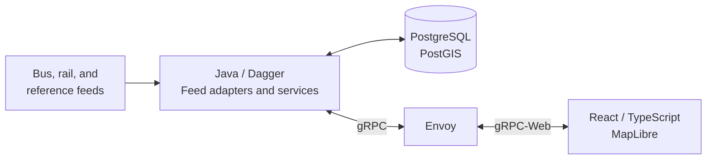

<div align="center">


# Transport for Melton

***Powered by pies. 🥧***

Bus and train departures, live buses, and route maps for Melton Mowbray.

[](https://github.com/parkie213/tfm/actions/workflows/ci.yml)
[](LICENSE)
[](docs/development.md#validation)
[](frontend/package.json)

[Why TfM?](#why-tfm) · [Features](#features) · [Quick start](#quick-start) · [How it works](#how-it-works) ·
[Engineering notes](#engineering-notes) · [Development](docs/development.md)

</div>

## Why TfM?

I quite like using the buses in London. The live departure boards at the bus stops are great,
so I thought: what if the local shops had a departure board? I could be sitting in Spoons until
the bus is a minute away.

The UK has quite a lot of really good freely available transport data, so I put it together
and hosted it at tfm.org.uk. It's not running there any more, but the code is here.

Once it was deployed, my Grandad and I took it for a spin and got the bus into town. The app
worked well, but I was shocked at the price of a ten-minute bus journey and I haven't taken
the bus since.

Another time, I was getting the train to Birmingham. The station board and platform announcement
were reporting a 40-minute delay, while TfM was showing a seven-minute delay from Darwin.
Darwin turned out to be right. 🤷

This was one of my first projects with Claude. When I decided to shut down the VPS, I thought
it was worth keeping around as a portfolio project. Before publishing it, I split the Java
backend into smaller modules with clearer responsibilities.

## Features

### Explore the town


- Search for a stop or place, or find nearby stops with a one-shot location lookup.
- Select a stop for its departures, then open a service to see its calling points.
- Browse bus routes and follow live vehicles where the upstream feed provides coverage.
- Check train departures, delays, platforms, and operator-supplied coach information.

### Put it on a screen


The kiosk view brings a local map and bus and train boards together in a layout for a larger
screen. Choose an address to show nearby stops and walking-distance estimates, then leave the
boards to update. Open it with `?view=tv`.

### Know where the data stands

<details>
<summary>See the data-sources view</summary>

<br>


</details>

Feed availability and freshness have their own page. Live information depends on upstream
coverage; an absent bus marker does not mean that a service is not running. Optional Darwin
feeds add train calling points and platform occupancy.

## Quick start

> **Requires** Docker with the Compose plugin and an internet connection.
> Scheduled buses and the map work without credentials; live buses and trains need your own
> upstream subscriptions.

From the repository root:

```bash
cp deploy/.env.example deploy/.env
# Optional: add live-feed credentials to deploy/.env.
cd deploy
docker compose up --build
```

Open **http://localhost:5174** for the map or **http://localhost:5174/?view=tv** for the kiosk.

The first run downloads stop and locality data and the East Midlands bus timetable. Allow
several minutes for boards and routes to populate. The Java container defaults to a 3 GB heap;
allow additional memory for PostgreSQL and image builds. The map uses the hosted OpenFreeMap
Liberty style, with no basemap archive or API key to configure.

The stack binds its published ports to localhost. To stop it, run `docker compose down` from
`deploy/`; the database and downloaded timetable cache persist between runs.

### Optional feeds

| Setting | Enables |
| --- | --- |
| `BODS_API_KEY` | Live bus positions from BODS SIRI-VM |
| `DARWIN_TOKEN` | Live train departures from RDM LDBWS |
| `DARWIN_ARRIVALS_BASE_URL`, optionally `DARWIN_ARRIVALS_TOKEN` | Train arrivals from an arrivals product |
| `DARWIN_KAFKA_*` | Train calling points, headcodes, and platform occupancy |

A fresh database gains train journey-detail coverage as Kafka schedules arrive. Unconfigured
live features show unavailable states. See the [environment example](deploy/.env.example) and
[Darwin integration notes](docs/darwin-timetable.md) for configuration.

## How it works

TfM brings several transport feeds into one local view. Bus timetables supply scheduled
departures and route shapes; live vehicle reports add positions. Train boards come from
RDM LDBWS, with optional Darwin Kafka schedules for journey and platform details.



The backend runs as one application, with separate modules for the transport model, feed
adapters, persistence, and services. Background loaders ingest reference and timetable data;
shared server streams deliver board and bus updates. The map and kiosk use the same Protobuf
API, with generated Java and TypeScript types.

Route geometry uses GTFS shapes. A separately managed OSRM server can optionally provide road
routing; it is not required by the local stack.

## Engineering notes

### Importing a regional timetable without filling the heap

The original GTFS importer parsed the entire feed into Java collections before writing to
PostgreSQL. The failing East Midlands feed was a 253 MB ZIP containing roughly 20.9 million
shape points and 4.6 million stop times. Expanding those compressed CSV rows into millions of
Java objects and strings exhausted a 3 GB heap. Memory pressure also disrupted unrelated
live-feed threads.

The replacement reads each table row by row, sending small batches to PostgreSQL using its
bulk-loading command, `COPY`, rather than keeping the whole feed in memory. The
[GTFS reader](backend/tfm-adapter-gtfs/src/main/java/uk/org/tfm/adapter/gtfs/GtfsTimetableSource.java)
handles the CSV files; the
[database importer](backend/tfm-storage-postgres/src/main/java/uk/org/tfm/storage/postgres/PostgresTimetableImporter.java)
owns the write buffer and transaction. If parsing or writing fails, the transaction rolls back
so a partial timetable is not saved.

In a real-feed check on 2 November 2026, using a 253 MB East Midlands ZIP:

| | Original importer | Streaming importer |
| --- | --- | --- |
| Heap limit | 3 GB | 1 GB |
| Result | Out of memory | Completed |
| Container memory during load | Over 3 GB before failure | Roughly 260–310 MB steady; around 800 MB at JVM startup |
| Rows imported | Load failed | 4.6 million stop times and 20.9 million shape points |
| Timetable load time | Load failed | 121 seconds, followed by an 85-second geometry rebuild |

Tests compare database contents against the original importer, check rollback on a broken
feed, and import two million synthetic rows in a separate JVM with a 128 MB heap to guard
against collecting the feed in memory again.

One remaining limitation: timetable replacement holds a database lock during the load, so
timetable reads can wait for roughly two minutes. Loading into staging tables before a short
swap is a future improvement.

## Development

The [development guide](docs/development.md) covers frontend hot reload, backend tests,
module structure, and regenerating the API types. Backend validation uses JDK 25 and Maven;
frontend validation uses Node.js 26 and npm. CI runs both builds.

Backend tests cover feed parsing, timetable handling, bus progress estimation, route geometry,
and selected service behavior. The frontend has type checking and build validation, with
[manual smoke checks](docs/user-journeys.md) for the main user journeys.

## Data and attribution

Bus data comes from BODS GTFS and SIRI-VM; stops and places from NaPTAN/NPTG; train boards from
RDM LDBWS, with optional Darwin schedules and platforms. Maps are provided by OpenFreeMap
with OpenStreetMap data. See the [in-app attribution page](frontend/src/pages/AboutView.tsx).

TfM is a personal project, unaffiliated with transport operators or local authorities.
Source code is [MIT licensed](LICENSE). Third-party data and assets retain their own terms
and attributions.

<div align="center">
<br>
<sub>Made for Melton Mowbray. Powered by pies.</sub>
</div>
